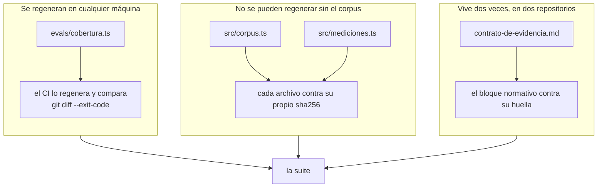

# writing-harness

Quince skills de redacción en español y un verificador que mide si un texto las
cumple. Trece de esas skills son tonos. Las skills son prosa que vos leés; el
verificador es un programa que cuenta. Lo que hace útil al conjunto es que las
dos mitades declaran las mismas reglas y un gate las obliga a no contradecirse.

Este es el archivo canónico de instrucciones para cualquier agente que trabaje
acá. `CLAUDE.md` solo apunta a este. Si tu herramienta lee otro nombre de
archivo, hacé lo mismo: un puntero de una línea, nunca una copia.

## Empezá por acá: hay dos modos y no se mezclan

| Lo que te pidieron | Modo | Dónde está el procedimiento |
|---|---|---|
| Escribir, reescribir o revisar un texto en español | **usar** | La parte I de este archivo |
| Agregar un tono, una regla o un corpus; tocar el verificador, un gate o una cifra | **mejorar** | [CONTRIBUTING.md](CONTRIBUTING.md) |

La diferencia no es de tamaño, es de qué se toca. **Usar el arnés no modifica
ningún archivo del arnés.** Si al escribir un texto te dan ganas de ablandar una
regla que te molesta, estás cruzando de modo sin darte cuenta, y eso es
exactamente el movimiento que este repositorio existe para hacer visible: la
regla se arregla o se retira con su motivo escrito, nunca se esquiva para que
pase un texto concreto.

Un mismo pedido puede necesitar los dos, y entonces son dos trabajos seguidos y
en este orden: primero entregás el texto, después proponés el cambio al arnés
con lo que aprendiste escribiéndolo. Los mejores arreglos de este repositorio
salieron así.


---

# Parte I. Usar el arnés

## 1. El procedimiento entero, en una pantalla

```bash
node src/cli.ts --enrutar <rasgo,rasgo>          # 1. qué tono corresponde
                                                  # 2. leer ese SKILL.md entero
                                                  # 3. escribir
node src/cli.ts <archivo> --tono <id>            # 4. medir
                                                  # 5. corregir y repetir
```

Cinco pasos y ninguno es opcional. El más saltado es el segundo, y es el que
hace la diferencia: el verificador cubre 104 de las 283 declaraciones que hacen
las skills. Las otras 179 solo las pone quien leyó la skill.

## 2. Elegir el tono

No lo elijas a ojo. El enrutamiento es un procedimiento determinista y responde
con el motivo, para que se pueda discutir:

```bash
node src/cli.ts --enrutar juridico
```

```
schiavenato-writing
  Divulgación jurídica y política dirigida a una comunidad.
  Paso 5 de 13 de la lista de spanish-writing §3.
```

Los rasgos son los de `RASGOS` en `src/enrutamiento.ts`, y el mismo comando sin
argumentos válidos los lista. Siempre devuelve un tono: un texto sin tono no es
un texto neutro, es un texto cuya forma no decidió nadie.

**Si el usuario pide un tono por su nombre, ese tono se aplica y la lista no se
recorre.** La tabla de §3 enruta, no cerca. Cada fila nombra el caso donde ese
tono se encuentra casi siempre, que es además el caso que midió su corpus, y no
dice de qué se puede escribir con esa forma. Lo único que un tono puede exigir
es la precondición de forma que declara al final de su sección 1.

## 3. Escribir con la skill delante

Leé el `SKILL.md` completo del tono elegido, no su resumen. Están en
`skills/<id>-writing/SKILL.md` y traen, en este orden: qué decide ese tono, qué
se midió y qué no vale de esa medición, el ritmo en cifras, la voz, la
estructura, los recursos, y una lista de verificación numerada al final.

Se leen además dos siempre:

- `skills/spanish-writing/SKILL.md` es la base y rige en todos los casos.
- `skills/humanizar-espanol/SKILL.md` solo si el usuario pidió humanizar con
  esas palabras.

## 4. Verificar

Todo texto en español que se produzca trabajando en este repositorio pasa por
el verificador antes de entregarse.

```bash
node src/cli.ts <archivo> --tono <id> [--pasada humanizar]
```

Sin `--tono` corre solo la capa normativa, que rige siempre. Con `--tono` añade
las longitudes y el ritmo de ese registro. El tono se elige según la tabla de
enrutamiento de `skills/spanish-writing/SKILL.md` §3. Por defecto, `camus`.

`--pasada humanizar` añade el catálogo de señales de IA. No corre solo, igual
que la skill: `humanizar-espanol` se activa únicamente cuando se pide con esas
palabras. Correrlo siempre marcaría como defecto cosas que en un texto concreto
son la palabra exacta.

Sale con 1 si hay errores. Un texto con errores no se entrega. Las advertencias
no frenan la entrega: señalan lo que solo el contexto decide.

Cada hallazgo trae la línea, la columna, la sección de la skill que lo enuncia y
qué hacer en su lugar. Señalar sin arreglar no sirve.

## 5. Medir la señal de IA, cuando se humaniza

Esto no corre siempre. Corre en el mismo caso que la pasada: cuando el usuario
pidió humanizar con esas palabras. Y es opcional además de eso, porque necesita
una herramienta que el arnés no trae.

El motivo de que exista es concreto. El verificador cuenta: longitudes, rachas,
patrones. Dos de las afirmaciones centrales de `humanizar-espanol` no se cuentan,
porque son magnitudes estadísticas sobre el texto entero: cuán previsible es cada
palabra, y cuánto varía esa previsibilidad de una oración a otra. Ninguna regla
las va a cubrir. `detector/` las mide.

```bash
python detector/score_es.py <archivo>              # la línea de base
python detector/diagnostico.py <archivo> 12        # qué párrafos reescribir
```

El ciclo es este:

1. Medir el texto original.
2. Aplicar `humanizar-espanol` entera, con su propia auditoría, y volver a medir.
3. Diagnosticar por párrafo y reescribir los peor puntuados con las reglas de la
   skill, no con las del detector.
4. Volver a medir y parar.

**Una pasada dirigida y se cierra.** El techo que la evidencia numérica sostiene
son dos, y está escrito para quien tenga un motivo y lo diga en voz alta, pero el
valor por defecto es una. La diferencia entre los dos números no es un descuido:
`evals/detector.ts` la explica y un gate la sostiene.

Cuatro cosas que no se hacen acá, y las cuatro por el mismo motivo:

- **No se itera hasta que el número baje.** Iterar contra la métrica produce el
  parafraseo uniforme que los detectores marcan, que es Goodhart con otro nombre.
  La ganancia por pasada cae a la mitad y lo que se gasta mientras tanto es voz.
- **No se reescriben los párrafos de método ni de datos** aunque un juez los
  marque. Cifras, criterios y listas de categorías tienen que ser llanas, y la
  varianza entre lo llano y lo particular es justamente la señal.
- **No se compara entre fragmentos de distinto tamaño.** La curvatura agregada
  crece con la longitud: solo se comparan versiones del mismo fragmento.
- **No se reporta un puntaje como prueba de autoría.** No lo es, ni este ni el de
  ningún servicio web. Es una señal estadística y se entrega diciéndolo.

Qué juez se usa en cada punto, y por qué ese y no otro, está en
[detector/README.md](detector/README.md). Sale de comparar cinco candidatos sobre
un corpus etiquetado, no de una preferencia.

Cuando el detector no está, este paso no corre y el resto del procedimiento no
cambia. Lo que se pierde es la medición, no la entrega.

## 6. Lo que el verificador no ve

De las 283 declaraciones que hacen las skills, **179 exigen juicio sobre el
contenido** y ninguna regla las va a cubrir. Cosas como si se conservó toda la
información del original, si una analogía está desarrollada o solo mencionada,
o si una expresión es la colocación más previsible del tema.

El número lo empujan los once tonos que reconstruyen a un autor: describir cómo
argumenta una persona no lo mide ninguna clase de regla que exista hoy.

Las skills declaran de dos maneras y las dos cuentan: ítems numerados `N. ¿…?`
en las listas del `SKILL.md`, y patrones `### N. Título` en los catálogos de
`references/`. `humanizar-espanol` declara solo de la segunda manera, con sus
38 patrones.

`evals/cobertura.ts` los tiene listados uno por uno. Salir con 0 significa que
el texto pasó las reglas mecanizables, no que esté bien escrito. Esa segunda
parte sigue siendo lectura humana, y la lista de verificación del final de cada
skill es la forma de hacerla.

## 7. Lo que no se hace al usar

- **No se toca una regla para que pase un texto.** Si la regla está mal, eso es
  el modo mejorar, va con su motivo escrito y lleva su gate.
- **No se entrega con errores.** El código de salida es la decisión, no una
  sugerencia.
- **No se silencian las advertencias sin decir por qué.** Una advertencia
  justificada se justifica en voz alta, en la entrega.
- **No se corre `--pasada humanizar` por rutina.** Marca como defecto giros que
  en un texto concreto son la palabra exacta.
- **No se copia el `SKILL.md` al texto.** La skill decide la forma; no aparece
  en el entregable.


---

# Parte II. Cómo está hecho

Esta parte no es un procedimiento. Es lo que hay que entender para que las dos
partes de arriba tengan sentido, y lo que hay que respetar en el modo mejorar.

## Las tres capas

| Capa | Qué decide | Cuándo corre |
|---|---|---|
| Base | Qué es correcto en español | Siempre |
| Tono | Cómo suena | Se elige exactamente una |
| Pasada | Qué se le hace a un texto ya escrito | Solo si el usuario la pide |

Se componen en `rulesFor`. La base nunca cede nada: `spanish-writing` §3.1 dice
que ninguna capa de encima puede contradecirla, y eso incluye a las pasadas.

## Una pasada releva al tono en lo que gobierna

Las capas se componen en `rulesFor`. La base siempre, el tono si se pidió, las
pasadas si se pidieron. Lo que no era cierto hasta hace poco es la última parte:
una pasada puede retirar reglas del tono.

Cada regla de tono declara qué dominio gobierna, y `DOMINIO_POR_CLASE` es la
única fuente de qué dominio le toca a cada clase: `ritmo-de-oracion` para las de
longitud, racha, banda y media, `ritmo-de-parrafo` para las de párrafo. Cada
pasada declara qué releva con `anula`. `evals/precedencia.test.ts` cubre las tres
combinaciones, porque el defecto vivía en la combinación y no en las piezas: sin
pasada, con pasada y sin tono, y con las dos.

El dominio empezó siendo uno solo y era demasiado grueso. Con `ritmo` a secas, la
pasada se llevaba el techo de párrafo del tono sin traer nada que midiera
párrafos, y un párrafo de cuatrocientas palabras pasaba limpio.

`assertDominios` falla en las dos direcciones. Una regla marcada con el dominio
equivocado sobrevive a una pasada que debería relevarla, o desaparece ante una
que no. Y una pasada que releva el ritmo de oración tiene que acotarlo por los
dos lados: si trae con qué cazar la cadena de breves y nada para la de largas,
relevar deja pasar la uniformidad contraria. Eso ocurrió: un texto de diecinueve
oraciones de treinta y cinco palabras seguidas salía limpio con la pasada puesta,
que es justo lo que su propio catálogo prohíbe.

El defecto que esto cierra no lo encontró una lectura del código. Lo encontró
escribir un texto humanizado y verlo salir con código 1, once veces por la misma
regla, con un arreglo propuesto que deshacía el trabajo.

## Un tono acota por forma, no por materia

Una skill de tono decide cómo suena un texto, no de qué trata. Cinco acotaban
por el objeto. Dos siguen en el repositorio: `atenas` exigía una obra de ficción
y `bettatech` un mecanismo de cómputo. Las otras tres, `sekkyoku`, `medicendai`
y `kenway`, se retiraron después y por otro motivo. Escrito así, quien pidiera
`atenas` para un asunto real se topaba con una skill que se negaba a existir
para él, y eso contradice a la base: §3 recorre la lista solo «si el usuario no
indica el tono», y §3.1 dice que ninguna skill de tono puede contradecirla.

Ahora todas cierran su sección 1 con una precondición de forma, que es lo
que la forma necesita para funcionar. Una figura que corregir. Unidades que
citar. Un orden dado de antemano. Algo con mérito y con defecto. Un mecanismo
que el lector usa a ciegas. Un procedimiento que el lector ejecuta. Nada de eso
es un tema, y cada una dice además de qué dominio salió su corpus, que es
distinto de dónde se puede usar.

`evals/alcance.test.ts` lo vigila en las dos direcciones. La base declara en qué
sección vive la precondición y el test la busca ahí, así que mover el bloque sin
mover la afirmación rompe, y al revés también.

Lo que ese gate no hace es leer la precondición y juzgarla. Distinguir una
condición de forma de una condición de tema es lectura, no expresión regular, y
una expresión regular que lo intentara daría verdes falsos. El gate obliga a
responder la pregunta; que la respuesta sea buena se revisa leyendo.

## La separación que hay que respetar

Las skills declaran reglas. El verificador las mide. **No se mencionan entre
sí.**

Ninguna skill nombra al verificador, ni a Node, ni a este repositorio. Una
skill tiene que servir en una máquina donde este verificador no existe, y el
verificador tiene que servir sobre un texto escrito sin ninguna skill cargada.
Lo único que comparten es el conjunto de reglas, y viven una sola vez, en
`src/rules.ts`.

Si alguna vez hace falta que una skill invoque una herramienta, la respuesta no
es agregarle la invocación. Es preguntarse por qué la herramienta no puede
correr desde afuera.

La misma regla vale para el proveedor. Las skills no nombran a ningún modelo ni
a ningún fabricante. Dicen «el agente» y describen qué papel cumple.

`evals/separacion.test.ts` lo comprueba en las dos direcciones y sin depender de
que nadie se acuerde.

## De dónde salieron las cifras

Las skills enuncian centenares de cifras medidas sobre un corpus que no vive acá
y no va a vivir. Son transcripciones ajenas y un libro; se juntaron para
construir las skills y se borran.

`src/corpus.ts` es lo que sobrevive: 15 corpus, 328 archivos, cada uno con su
tamaño, sus palabras y su sha256. Una skill dice «medido sobre 20
transcripciones» y nunca dice cuáles. Acá está la lista, con el contenido exacto
fijado, así que una cifra puede nombrar su origen aunque el origen ya no exista.

`src/mediciones.ts` es la otra mitad: 71 mediciones sobre 302 archivos. El
manifiesto dice qué archivos había; esto dice qué contenían. Cada medición trae
las cuatro casillas que hacen comprobable una cifra: qué afirma, con qué regla se
produjo, sobre cuántos archivos y en qué unidad.

Trae además las 1.291 expresiones que las skills entrecomillan, contadas en su
propio corpus; 904 aparecen en él. Una skill afirma que tal giro sale 191 veces y
esa cuenta no se puede rehacer sin el corpus, así que están todas, incluidas las
387 que dan cero. Un cero es una medición: dice que la expresión no estaba ahí.

**Esas cuentas se quedan cortas en las expresiones de varias palabras, y no tiene
arreglo.** Se buscaron como literal, con un solo espacio entre sus palabras, pero
una transcripción viene partida en líneas de subtítulo y un giro de dos palabras
cae a menudo a caballo entre dos: «por ejemplo» con un salto dentro no coincide
con «por ejemplo». Medido en `evals/expresiones.test.ts`: las de una palabra
coinciden con la prosa siete de cada diez veces y las de varias, una de cada ocho,
siempre por debajo. **En las de varias palabras, la cifra buena es la de la
prosa.** El corpus ya no está y `src/mediciones.ts` está fijado por su huella, así
que la tabla no se puede corregir; queda medido para que nadie la lea como
exacta.

Cómo se incorpora un corpus nuevo está en [CONTRIBUTING.md](CONTRIBUTING.md).

**El texto que cuenta no es el archivo entero.** Una transcripción trae cabecera
de metadatos y una marca `**[mm:ss]**` por línea; contar eso infla el recuento
alrededor de un 15 %. Se cuenta lo que viene después de «## Transcripción», sin
las marcas. Las fichas de han no tienen transcripción y se cuentan enteras, y el
dato lo dice en su campo `fuente`.

Ninguno de los dos es un derivado, y su gate es distinto por eso. El CI no puede
regenerarlos ni compararlos, porque en esa máquina el corpus no está; así que
`evals/corpus.test.ts` y `evals/mediciones.test.ts` comparan cada archivo contra
su propia huella. Cualquier edición a mano los rompe, incluida la que sustituye
un sha256 por otros sesenta y cuatro hexadecimales con buena pinta, que es justo
lo que ningún otro gate podría notar una vez borrado el corpus.

Además, la prosa y la medición se comparan entre sí. Tres corpus dan exacto, ocho
caen dentro del 0,5 % y han se sale porque sus cifras salen del libro y no de las
fichas. El primero de los tres exactos es `adria-sola`, y lo es por un motivo
distinto de los otros dos: su cifra se copió de la salida de este mismo script en
vez de venir de un conteo anterior. Las diferencias están congeladas como dato:
impedir que crezcan sin que nadie lo note es distinto de fingir que no existen.

Ninguna skill nombra el manifiesto ni las mediciones, igual que ninguna nombra
una regla. La skill declara, el verificador mide.

## El contrato de evidencia

[contrato-de-evidencia.md](contrato-de-evidencia.md) vive dos veces: acá y en el
repositorio de diapositivas, que llegó a las mismas cuatro casillas por su cuenta
midiendo cómo se justifica un argumento. **Lo que se comparte son cuatro nombres,
no código.** No hay paquete, ni tipo compartido, ni archivo que uno genere y el
otro consuma; cada lado lo aplica con su propia máquina y sigue funcionando si el
otro desaparece.

Solo el bloque marcado es normativo, y cada copia declara su huella en su suite.
Tocarlo de un lado hace fallar ese lado, y las dos huellas dejan de coincidir a
la vista. Nada avisa automáticamente de que el otro se movió: ese es el precio de
no acoplarlos, y lo que se compra es que ningún cambio pueda ser silencioso.

`evals/contrato.test.ts` comprueba las dos cosas que corresponden a este lado: que
el bloque no cambió, y que las mediciones lo cumplen. La segunda es la que evita
que el contrato se vuelva un adorno, porque un documento que nadie comprueba dice
lo que a cada uno le convenga que diga.

## Que el gate no dependa de que alguien se acuerde

Dos redes, y las dos corren lo mismo.

```bash
node scripts/instalar-hook.ts     # aviso temprano, aborta el commit
node scripts/instalar-hook.ts --desinstalar
```

El hook se copia en vez de enlazarse, porque Git no sigue enlaces en todas las
plataformas y un hook que no corre es peor que no tenerlo: da la sensación de
estar cubierto. El precio es reinstalarlo cuando el archivo cambia. Para saltarlo
en un caso concreto, `git commit --no-verify`, que existe a propósito.

`.github/workflows/gate.yml` es la red de verdad, la que no se puede saltar.
Corre la suite y comprueba que `evals/cobertura.ts` esté regenerado.

No todos los archivos generados se protegen igual, y conviene tener presente por
qué:



El de arriba se compara con lo que produce el generador. Los del medio no pueden:
en la máquina del CI el corpus no está, así que se comparan consigo mismos. El de
abajo tampoco, porque su otra mitad vive en otro repositorio que este no importa.

Un juicio encontró diez defectos en este repositorio, y los encontró porque los
buscamos a mano. Estas dos redes existen para que la próxima vez no dependa de
eso.

## Requisitos

Node 22.6 o superior, nada más. El repositorio no tiene dependencias, ni build,
ni `package-lock`. Corre offline.

`detector/` es la excepción y por eso vive aparte. Necesita Python, PyTorch y dos
modelos descargados, y nada de `src/` lo importa ni la suite lo invoca. Quien no
lo instale pierde el paso 5 y ningún otro: el arnés sigue siendo Node y sigue
corriendo offline. Meterlo dentro habría convertido esa frase en mentira.

## Las skills instaladas son enlaces

`node scripts/instalar.ts` enlaza cada skill desde el directorio del anfitrión
hacia este repositorio, con una junction en Windows y un symlink en el resto.
Editar el repositorio cambia lo instalado en el momento. No copiar nunca: dos
copias divergen, y eso es el defecto que este repositorio existe para evitar.

El destino por defecto es `~/.agents/skills`, la convención entre clientes.
Cada herramienta mantiene además su propio directorio.

```bash
node scripts/instalar.ts                   # solo ~/.agents/skills
node scripts/instalar.ts --todos           # además, cada anfitrión que exista
node scripts/instalar.ts --destino <ruta>  # uno concreto, repetible
node scripts/instalar.ts --verificar
node scripts/instalar.ts --desinstalar
```

El script nunca borra nada. Si el nombre está ocupado por un directorio real,
se detiene y sale con 1. Con `--reemplazar` lo renombra a
`<nombre>.reemplazado` y enlaza al lado, así que siempre se puede volver atrás.

El formato `SKILL.md`, markdown con frontmatter YAML, lo lee cualquier
herramienta. Si la tuya no tiene un directorio de skills, las skills siguen
sirviendo como documentos: se leen y se aplican igual.

**Cuidado con las copias sueltas.** Una skill enlazada y una copia vieja del
mismo nombre en otro directorio de anfitrión son dos reglas distintas con el
mismo título. Ya pasó: había un `spanish-writing` en `~/.agents/skills` idéntico
al primer commit de este repositorio, con la filosofía Camus todavía dentro de
la base. `--verificar` sobre cada anfitrión es lo que las encuentra.

**Y cuidado con los enlaces colgando, que es el mismo daño por el otro lado.**
Mover el repositorio no reescribe los enlaces que apuntan a donde estaba: siguen
ahí, con su nombre correcto, apuntando a una carpeta que ya no existe. Ninguna
skill está instalada y el listado parece completo. Ya pasó también, y con las
trece a la vez.

`--verificar` las distingue: una skill enlazada a este repositorio dice
`enlazado`, y una que apunta a otro sitio dice `enlazado-a-otro` con el destino
al lado. Ese destino es lo que hay que leer, no el nombre. Se arregla con
`--reemplazar`, que renombra en vez de borrar.

## Dónde está cada cosa

| Ruta | Qué es |
|---|---|
| `skills/spanish-writing/` | La base. Rige siempre, y su §3 tiene la tabla de enrutamiento |
| `skills/<id>-writing/` | Un tono |
| `skills/humanizar-espanol/` | La pasada. Solo si el usuario la pide |
| `src/rules.ts` | Las 87 reglas como datos, sin comportamiento y sin build |
| `src/check.ts` | Compone las capas y mide |
| `src/enrutamiento.ts` | La tabla de §3 como dato, y el procedimiento que decide |
| `src/corpus.ts`, `src/mediciones.ts` | El registro del corpus borrado. No se editan a mano |
| `evals/` | Los gates. Cada uno falla en las dos direcciones |
| `scripts/` | Manifiesto, medición, instalación y hook |
| `detector/` | La herramienta opcional que mide la señal de IA. Corre por fuera |

## Qué archivo lee cada anfitrión

| Anfitrión | Archivo |
|---|---|
| Cualquiera que siga la convención AGENTS.md | `AGENTS.md` |
| Claude Code | `CLAUDE.md`, que apunta a `AGENTS.md` |
| Otro | Agregá un puntero de una línea, no una copia |

Un puntero no se desincroniza. Una copia sí.
