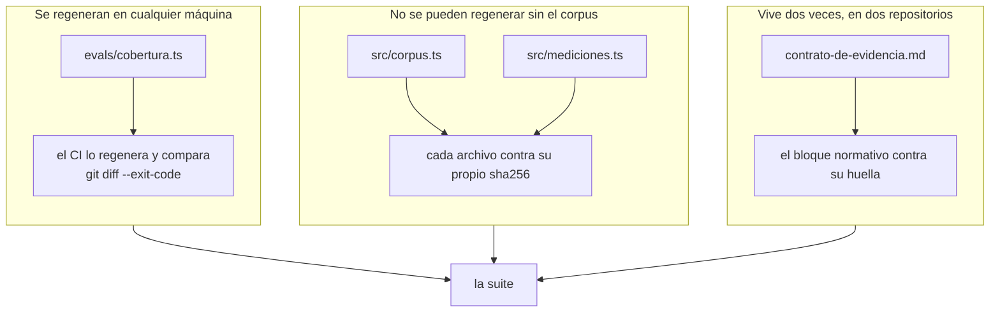

# writing-harness

Skills de redacción en español y el verificador que mide si un texto las cumple.

Este es el archivo canónico de instrucciones para cualquier agente que trabaje
en este repositorio. `CLAUDE.md` solo apunta acá. Si tu herramienta lee otro
nombre de archivo, hacé lo mismo: un puntero de una línea, nunca una copia.

## La separación que hay que respetar

Las skills declaran reglas. El verificador las mide. **No se mencionan entre
sí.**

Ninguna skill nombra al verificador, ni a Node, ni a este repositorio. Una
skill tiene que servir en una máquina donde este verificador no existe, y el
verificador tiene que servir sobre un texto escrito sin ninguna skill cargada.
Lo único que comparten es el conjunto de reglas, y viven una sola vez, en
`src/rules.ts`.

Si alguna vez hace falta que una skill invoque una herramienta, la respuesta no
es agregarle la invocación. Es preguntarse por qué la herramienta no puede
correr desde afuera.

La misma regla vale para el proveedor. Las skills no nombran a ningún modelo ni
a ningún fabricante. Dicen «el agente» y describen qué papel cumple.

## Regla operativa

Todo texto en español que se produzca trabajando en este repositorio pasa por
el verificador antes de entregarse.

```bash
node src/cli.ts <archivo> --tono <id> [--pasada humanizar]
```

Sin `--tono` corre solo la capa normativa, que rige siempre. Con `--tono` añade
las longitudes y el ritmo de ese registro. El tono se elige según la tabla de
enrutamiento de `skills/spanish-writing/SKILL.md` §3. Por defecto, `camus`.

`--pasada humanizar` añade el catálogo de señales de IA. No corre solo, igual
que la skill: `humanizar-espanol` se activa únicamente cuando se pide con esas
palabras. Correrlo siempre marcaría como defecto cosas que en un texto concreto
son la palabra exacta.

Sale con 1 si hay errores. Un texto con errores no se entrega. Las advertencias
no frenan la entrega: señalan lo que solo el contexto decide.

## Lo que el verificador no ve

De las 235 declaraciones que hacen las skills, **146 exigen juicio sobre el
contenido** y ninguna regla las va a cubrir. Cosas como si se conservó toda la
información del original, si una analogía está desarrollada o solo mencionada,
o si una expresión es la colocación más previsible del tema.

El número lo empujan los diez tonos que reconstruyen a un autor: describir cómo
argumenta una persona no lo mide ninguna clase de regla que exista hoy.

Las skills declaran de dos maneras y las dos cuentan: ítems numerados `N. ¿…?`
en las listas del `SKILL.md`, y patrones `### N. Título` en los catálogos de
`references/`. `humanizar-espanol` declara solo de la segunda manera, con sus
37 patrones.

`evals/cobertura.ts` los tiene listados uno por uno. Salir con 0 significa que
el texto pasó las reglas mecanizables, no que esté bien escrito. Esa segunda
parte sigue siendo lectura humana.

## Antes de tocar reglas

```bash
node --test "evals/*.test.ts"
```

El test de correspondencia falla en las dos direcciones. Agregar una regla que
cubre un ítem obliga a borrarlo de `evals/cobertura.ts`. Cambiar la redacción
de un ítem en un `SKILL.md` obliga a actualizar el dato. Es a propósito: las
dos veces que este repositorio perdió una regla fue porque nadie comparaba la
prosa con el dato.

`evals/cobertura.ts` no se edita a mano. Se regenera:

```bash
node --experimental-strip-types evals/gen.ts
```

Conserva la clasificación de los ítems que ya estaban, imprime los nuevos para
revisarlos uno por uno, y deja los recuentos que el test tiene grabados. Se
escribió a mano una vez y quedó mintiendo en cuanto una skill movió sus ítems.

## Un tono acota por forma, no por materia

Una skill de tono decide cómo suena un texto, no de qué trata. Cinco acotaban
por el objeto. Dos siguen en el repositorio: `atenas` exigía una obra de ficción
y `bettatech` un mecanismo de cómputo. Las otras tres, `sekkyoku`, `medicendai`
y `kenway`, se retiraron después y por otro motivo. Escrito así, quien pidiera
`atenas` para un asunto real se topaba con una skill que se negaba a existir
para él, y eso contradice a la base: §3 recorre la lista solo «si el usuario no
indica el tono», y §3.1 dice que ninguna skill de tono puede contradecirla.

Ahora todas cierran su sección 1 con una precondición de forma, que es lo
que la forma necesita para funcionar. Una figura que corregir. Unidades que
citar. Un orden dado de antemano. Algo con mérito y con defecto. Un mecanismo
que el lector usa a ciegas. Nada de eso es un tema, y cada una dice además de
qué dominio salió su corpus, que es distinto de dónde se puede usar.

`evals/alcance.test.ts` lo vigila en las dos direcciones. La base declara en qué
sección vive la precondición y el test la busca ahí, así que mover el bloque sin
mover la afirmación rompe, y al revés también.

Lo que ese gate no hace es leer la precondición y juzgarla. Distinguir una
condición de forma de una condición de tema es lectura, no expresión regular, y
una expresión regular que lo intentara daría verdes falsos. El gate obliga a
responder la pregunta; que la respuesta sea buena se revisa leyendo.

## Una pasada releva al tono en lo que gobierna

Las capas se componen en `rulesFor`. La base siempre, el tono si se pidió, las
pasadas si se pidieron. Lo que no era cierto hasta ahora es la última parte:
una pasada puede retirar reglas del tono.

Cada regla de tono que gobierna el ritmo lo declara con `gobierna: 'ritmo'`, y
cada pasada declara qué releva con `anula`. `evals/precedencia.test.ts` cubre las
tres combinaciones, porque el defecto vivía en la combinación y no en las piezas:
sin pasada, con pasada y sin tono, y con las dos.

`assertDominios` falla en las dos direcciones. Una regla de ritmo sin marcar
sobreviviría a la pasada y le pediría al texto lo contrario que ella. Una regla
marcada que no es de ritmo desaparecería al pedir humanizar y nadie se enteraría.
Y una pasada que releva el ritmo sin traer reglas de ritmo lo dejaría sin
gobierno, que no es relevar sino apagar.

El defecto que esto cierra no lo encontró una lectura del código. Lo encontró
escribir un texto humanizado y verlo salir con código 1, once veces por la misma
regla, con un arreglo propuesto que deshacía el trabajo.

## De dónde salieron las cifras

Las skills enuncian centenares de cifras medidas sobre un corpus que no vive acá
y no va a vivir. Son transcripciones ajenas y un libro; se juntaron para
construir las skills y se borran.

`src/corpus.ts` es lo que sobrevive: 13 corpus, 305 archivos, cada uno con su
tamaño, sus palabras y su sha256, en 60 KB. Una skill dice «medido sobre 20
transcripciones» y nunca dice cuáles. Acá está la lista, con el contenido exacto
fijado, así que una cifra puede nombrar su origen aunque el origen ya no exista.

`src/mediciones.ts` es la otra mitad: 63 mediciones sobre 280 archivos. El
manifiesto dice qué archivos había; esto dice qué contenían. Cada medición trae
las cuatro casillas que hacen comprobable una cifra: qué afirma, con qué regla se
produjo, sobre cuántos archivos y en qué unidad.

Trae además las 1.260 expresiones que las skills entrecomillan, contadas en su
propio corpus; 884 aparecen en él. Una skill afirma que tal giro sale 191 veces y
esa cuenta no se puede rehacer sin el corpus, así que están todas, incluidas las
376 que dan cero. Un cero es una medición: dice que la expresión no estaba ahí.

**Esas cuentas se quedan cortas en las expresiones de varias palabras, y no tiene
arreglo.** Se buscaron como literal, con un solo espacio entre sus palabras, pero
una transcripción viene partida en líneas de subtítulo y un giro de dos palabras
cae a menudo a caballo entre dos: «por ejemplo» con un salto dentro no coincide
con «por ejemplo». Medido en `evals/expresiones.test.ts`: las de una palabra
coinciden con la prosa dos de cada tres veces y las de varias, una de cada nueve,
casi siempre por debajo. **En las de varias palabras, la cifra buena es la de la
prosa.** El corpus ya no está y `src/mediciones.ts` está fijado por su huella, así
que la tabla no se puede corregir; queda medido para que nadie la lea como
exacta.

```bash
node --experimental-strip-types scripts/manifiesto.ts
node --experimental-strip-types scripts/medir.ts
node --experimental-strip-types scripts/medir.ts --desde <ruta>
```

`medir.ts` comprueba el sha256 de cada archivo contra el manifiesto antes de
contar nada, y aborta si uno solo difiere. Medir un corpus distinto del que quedó
fichado daría cifras que parecen trazables y no lo son, que es peor que no tener
ninguna.

**El texto que cuenta no es el archivo entero.** Una transcripción trae cabecera
de metadatos y una marca `**[mm:ss]**` por línea; contar eso infla el recuento
alrededor de un 15 %. Se cuenta lo que viene después de «## Transcripción», sin
las marcas. Las fichas de han no tienen transcripción y se cuentan enteras, y el
dato lo dice en su campo `fuente`.

Ninguno de los dos es un derivado, y su gate es distinto por eso. El CI no puede
regenerarlos ni compararlos, porque en esa máquina el corpus no está; así que
`evals/corpus.test.ts` y `evals/mediciones.test.ts` comparan cada archivo contra
su propia huella. Cualquier edición a mano los rompe, incluida la que sustituye
un sha256 por otros sesenta y cuatro hexadecimales con buena pinta, que es justo
lo que ningún otro gate podría notar una vez borrado el corpus.

Además, la prosa y la medición se comparan entre sí. Dos corpus dan exacto, ocho
caen dentro del 0,5 % y han se sale porque sus cifras salen del libro y no de las
fichas. Las diferencias están congeladas como dato: impedir que crezcan sin que
nadie lo note es distinto de fingir que no existen.

Ninguna skill nombra el manifiesto ni las mediciones, igual que ninguna nombra
una regla. La skill declara, el verificador mide.

## El contrato de evidencia

[contrato-de-evidencia.md](contrato-de-evidencia.md) vive dos veces: acá y en el
repositorio de diapositivas, que llegó a las mismas cuatro casillas por su cuenta
midiendo cómo se justifica un argumento. **Lo que se comparte son cuatro nombres,
no código.** No hay paquete, ni tipo compartido, ni archivo que uno genere y el
otro consuma; cada lado lo aplica con su propia máquina y sigue funcionando si el
otro desaparece.

Solo el bloque marcado es normativo, y cada copia declara su huella en su suite.
Tocarlo de un lado hace fallar ese lado, y las dos huellas dejan de coincidir a
la vista. Nada avisa automáticamente de que el otro se movió: ese es el precio de
no acoplarlos, y lo que se compra es que ningún cambio pueda ser silencioso.

`evals/contrato.test.ts` comprueba las dos cosas que corresponden a este lado: que
el bloque no cambió, y que las mediciones lo cumplen. La segunda es la que evita
que el contrato se vuelva un adorno, porque un documento que nadie comprueba dice
lo que a cada uno le convenga que diga.

## Que el gate no dependa de que alguien se acuerde

Dos redes, y las dos corren lo mismo.

```bash
node scripts/instalar-hook.ts     # aviso temprano, aborta el commit
node scripts/instalar-hook.ts --desinstalar
```

El hook se copia en vez de enlazarse, porque Git no sigue enlaces en todas las
plataformas y un hook que no corre es peor que no tenerlo: da la sensación de
estar cubierto. El precio es reinstalarlo cuando el archivo cambia. Para saltarlo
en un caso concreto, `git commit --no-verify`, que existe a propósito.

`.github/workflows/gate.yml` es la red de verdad, la que no se puede saltar.
Corre la suite y comprueba que `evals/cobertura.ts` esté regenerado.

No todos los archivos generados se protegen igual, y conviene tener presente por
qué:



El de arriba se compara con lo que produce el generador. Los del medio no pueden:
en la máquina del CI el corpus no está, así que se comparan consigo mismos. El de
abajo tampoco, porque su otra mitad vive en otro repositorio que este no importa.

Un juicio encontró diez defectos en este repositorio, y los encontró porque los
buscamos a mano. Estas dos redes existen para que la próxima vez no dependa de
eso.

La separación de arriba la comprueba `evals/separacion.test.ts`, y no hace falta
correr nada a mano. Acá vivían dos `grep -r` que la hacían, y se fueron por el
mismo motivo por el que se fueron del CI: el segundo buscaba «cursor» suelto y
disparaba sobre la expresión «Tengo un precursor.», que un corpus contiene con
todo derecho.

Un juez encontró que esa receta, ya corregida en el test, seguía intacta acá y
seguía diciendo «tiene que dar vacío». **Una comprobación escrita en dos sitios
se arregla en uno solo**, que es la enfermedad que este repositorio existe para
evitar, cometida en su propio manual.

## Requisitos

Node 22.6 o superior, nada más. El repositorio no tiene dependencias, ni build,
ni `package-lock`. Corre offline.

## Las skills instaladas son enlaces

`node scripts/instalar.ts` enlaza cada skill desde el directorio del anfitrión
hacia este repositorio, con una junction en Windows y un symlink en el resto.
Editar el repositorio cambia lo instalado en el momento. No copiar nunca: dos
copias divergen, y eso es el defecto que este repositorio existe para evitar.

El destino por defecto es `~/.agents/skills`, la convención entre clientes.
Cada herramienta mantiene además su propio directorio.

```bash
node scripts/instalar.ts                   # solo ~/.agents/skills
node scripts/instalar.ts --todos           # además, cada anfitrión que exista
node scripts/instalar.ts --destino <ruta>  # uno concreto, repetible
node scripts/instalar.ts --verificar
node scripts/instalar.ts --desinstalar
```

El script nunca borra nada. Si el nombre está ocupado por un directorio real,
se detiene y sale con 1. Con `--reemplazar` lo renombra a
`<nombre>.reemplazado` y enlaza al lado, así que siempre se puede volver atrás.

El formato `SKILL.md`, markdown con frontmatter YAML, lo lee cualquier
herramienta. Si la tuya no tiene un directorio de skills, las skills siguen
sirviendo como documentos: se leen y se aplican igual.

**Cuidado con las copias sueltas.** Una skill enlazada y una copia vieja del
mismo nombre en otro directorio de anfitrión son dos reglas distintas con el
mismo título. Ya pasó: había un `spanish-writing` en `~/.agents/skills` idéntico
al primer commit de este repositorio, con la filosofía Camus todavía dentro de
la base. `--verificar` sobre cada anfitrión es lo que las encuentra.

## Qué archivo lee cada anfitrión

| Anfitrión | Archivo |
|---|---|
| Cualquiera que siga la convención AGENTS.md | `AGENTS.md` |
| Claude Code | `CLAUDE.md`, que apunta a `AGENTS.md` |
| Otro | Agregá un puntero de una línea, no una copia |

Un puntero no se desincroniza. Una copia sí.
