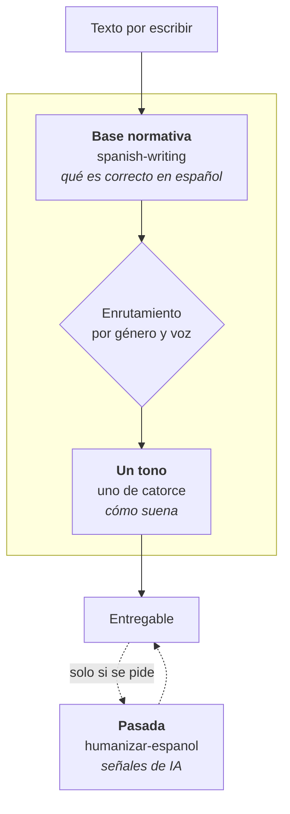
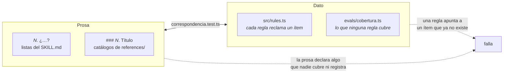
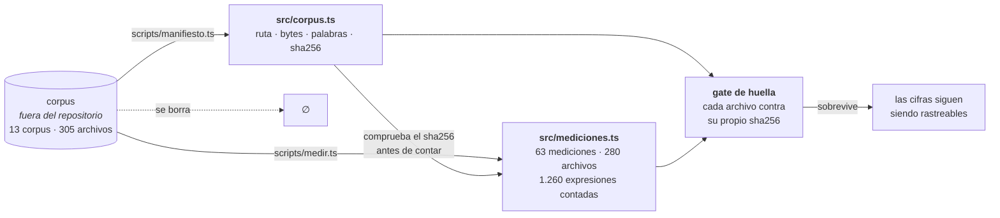
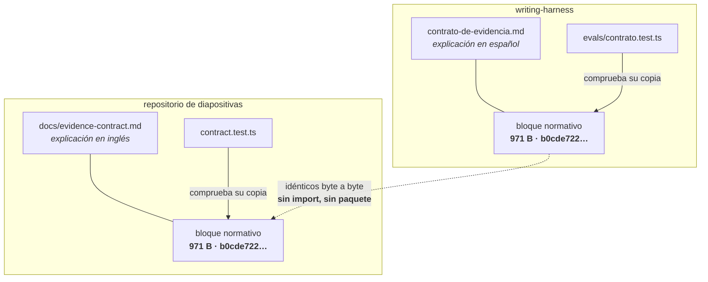

# writing-harness

Skills de redacción en español y el verificador que mide si un texto las cumple.

Dieciséis skills en tres capas y 61 reglas mecanizadas, con un gate que ata cada
regla a la prosa que la enuncia. Cero dependencias: Node 22.6 o superior lo corre
entero sin instalar nada, sin build y sin conexión.

## La idea

Las reglas del español no dependen del tono. La forma sí.

Antes, cada skill de tono repetía a mano las reglas de la base. Eso es herencia
por copia y pega: cuando una regla cambia hay que acordarse de tocar varios
archivos, y basta con olvidar uno para que dos skills digan cosas distintas sobre
la misma norma. Pasó de verdad con la raya, que estaba prohibida en una skill,
permitida en otra y marcada como señal de IA en una tercera.

Ahora cada regla vive en un solo lugar.



| Capa | Qué decide | Cuántas |
|---|---|---|
| **Base normativa** | Qué es correcto en español: gramática, anglicismos, puntuación, mayúsculas, números, léxico prohibido, citas, tratamiento, variedad, formato de entrega | 1 |
| **Tono** | Cómo suena: longitud de oración y párrafo, persona gramatical, conectores favorecidos, arquitectura del argumento | 14 |
| **Pasada** | Corre sobre un texto ya redactado, y solo si el usuario la pide con esas palabras | 1 |

### Regla de precedencia

Un tono puede **ampliar o restringir** lo que la base deja abierto. Nunca puede
contradecirla.

Si un tono parece autorizar algo que la base prohíbe, gana la prohibición, y ese
tono tiene un defecto que hay que corregir.

### Enrutamiento

`spanish-writing` se aplica siempre y elige exactamente un tono. La tabla
completa está en su §3; `camus-writing` es el que corre por defecto.

Trece de los catorce reconstruyen la forma de exponer de un autor concreto, y no
se escribieron a ojo: cada uno salió de medir un corpus de su prosa o de su
habla. Eso es lo que separa a este repositorio de una colección de instrucciones
de estilo.

## El verificador

Las skills son prosa que lee un modelo. El verificador mide si un texto entregado
las cumple. **No se nombran entre sí**: una skill tiene que servir en una máquina
donde este verificador no existe, y el verificador tiene que servir sobre un texto
escrito sin ninguna skill cargada. Lo único que comparten es el conjunto de
reglas, y vive una sola vez, en `src/rules.ts`.

```bash
node src/cli.ts documento.txt --tono camus
```

```bash
node --test "evals/*.test.ts"
```

Cuándo correrlo está en [AGENTS.md](AGENTS.md), que es donde va la operación del
producto. En las skills no.

| Archivo | Qué hace |
|---|---|
| `src/rules.ts` | Las 61 reglas como objetos planos y tipados, sin comportamiento |
| `src/text.ts` | Segmentador de texto plano. Sin AST, porque el entregable no lleva markdown |
| `src/check.ts` | Aplica las reglas y devuelve hallazgos con línea, columna y arreglo propuesto |
| `src/cli.ts` | Sale con 1 si hay errores, para encadenarlo en un hook o en CI |
| `src/corpus.ts` | La huella del corpus con el que se construyeron las skills |
| `src/mediciones.ts` | Qué contenía ese corpus, con las cuatro casillas del contrato |
| `evals/cobertura.ts` | El registro de qué declara la prosa y todavía no tiene regla |

Las reglas se reparten en once tipos. `forbidden-pattern` cubre 43; las otras
diez existen porque hay cosas que una expresión regular no ve: contar palabras
por párrafo, detectar rachas de oraciones breves, comparar aperturas
consecutivas, medir una proporción sobre el total, recorrer el texto con estado
para distinguir niveles de comilla.

`must-contain` es el reverso de todas las demás. Un tono no se define solo por lo
que prohíbe: `fonda-writing` exige interpelación, preguntas retóricas y voz
propia. Una regla que solo sabe prohibir no puede comprobar eso.

## El gate

Cada regla declara qué ítem de la prosa hace cumplir. El test de correspondencia
compara las dos representaciones y **falla en las dos direcciones**.



Existe porque el defecto ya ocurrió tres veces. La raya vivía en tres versiones
distintas. La prohibición del punto y coma se perdió entera al reescribir un ítem
de checklist. Y `humanizar-espanol` estuvo fuera del gate por completo, porque
declara sus reglas como patrones numerados en `references/` y el extractor solo
miraba las listas del `SKILL.md`: era la skill con más reglas y aportaba cero al
recuento. Las tres veces el error era invisible porque nadie comparaba las dos
representaciones.

Esa prohibición del punto y coma se retiró después por decisión, y el gate volvió
a servir: obligó a tocar las cinco skills que la repetían por su cuenta. **Retirar
una regla a propósito y perderla sin darse cuenta se parecen en el resultado y no
se parecen en nada más.**

### Cobertura declarada

| Estado | Declaraciones | Qué significa |
|---|---|---|
| cubierto | **83** | Tiene regla y test |
| mecanizable | **0** | Se puede medir, falta construirlo |
| criterio | 199 | Exige juicio sobre el contenido. Ninguna regla lo va a cubrir |

De las 282 declaraciones, 199 piden juicio: si se conservó toda la información
del original, si una analogía está desarrollada o solo mencionada, si una
expresión es la colocación más previsible del tema. El número creció con los
trece tonos que reconstruyen a un autor, porque describir cómo argumenta una
persona no lo mide ninguna clase de regla que exista hoy.

**El cero de `mecanizable` no es una ausencia verificada.** El generador nunca
asciende un ítem a esa clase: hereda la que tenía o pone `criterio`. Dice que
nadie ha clasificado nada como pendiente, no que no quede nada por hacer. Dos
jueces lo probaron señalando tres ítems que estaban en `criterio` y sí se podían
medir. Los tres tienen regla desde entonces.

`evals/cobertura.ts` no se edita a mano. Se regenera por medición:

```bash
node --experimental-strip-types evals/gen.ts
```

## El corpus que ya no está

Las skills enuncian centenares de cifras medidas sobre un corpus que nunca vivió
en este repositorio y nunca va a vivir. Son transcripciones ajenas y un libro;
se juntaron para construir las skills y se borran.



Una skill dice «medido sobre 20 transcripciones» y nunca dice cuáles.
`src/corpus.ts` tiene la lista, con el contenido de cada archivo fijado por su
sha256. `src/mediciones.ts` tiene lo que contenían, con las cuatro casillas que
hacen comprobable una cifra.

**El texto que cuenta no es el archivo entero.** Una transcripción trae cabecera
de metadatos y una marca de tiempo por línea; contarlo entero infla el recuento
alrededor de un 15 %, y hace parecer que las skills se equivocaron. Contando el
cuerpo, dos corpus dan exacto, ocho caen dentro del 0,5 % y los minutos de habla
coinciden en los cuatro que los declaran.

Esos ocho no se alinearon a la medición, y hay una razón medida: tres de sus
totales se descomponen exactamente en otras cifras de la misma prosa, así que
cambiarlos habría roto una aritmética que hoy está bien. Son dos sistemas
coherentes que no coinciden entre sí. Se conservan los dos y se congela la
diferencia.

**El gate de estos dos archivos es distinto del de los demás.** No se pueden
regenerar sin el corpus, y en el CI el corpus no está, así que cada uno se compara
contra su propia huella. Cualquier edición a mano los rompe, incluida la que
sustituye un sha256 por otros sesenta y cuatro hexadecimales con buena pinta, que
es justo lo que ningún otro gate podría notar una vez borrado el origen.

## El contrato de evidencia

[contrato-de-evidencia.md](contrato-de-evidencia.md) vive dos veces: acá y en un
repositorio de diapositivas que llegó a las mismas cuatro casillas por su cuenta,
midiendo cómo se justifica un argumento en una lámina.



**Lo que se comparte son cuatro nombres, no código.** `claim`, `method`,
`sources`, `unit`. No hay paquete, ni tipo compartido, ni archivo que uno genere y
el otro consuma. Borre cualquiera de los dos repositorios y el otro sigue
funcionando.

Solo el bloque marcado es normativo, y va en inglés; la explicación de cada lado
va en su idioma. Obligar a que la explicación coincidiera habría hecho que uno
escribiera en el idioma del otro, y el contrato no trata de eso.

Nada avisa automáticamente de que la otra copia se movió. Ese es el precio de no
acoplarlos, y lo que se compra es que **ningún cambio pueda ser silencioso**: si
alguien toca el bloque de un lado, ese lado falla y las dos huellas dejan de
coincidir a la vista.

## Instalación

Las skills se enlazan, no se copian. Editar el repositorio cambia lo instalado en
el momento.

```bash
node scripts/instalar.ts                   # solo ~/.agents/skills
node scripts/instalar.ts --todos           # además, cada anfitrión que exista
node scripts/instalar.ts --verificar
```

Dos copias divergen, y eso es el defecto que este repositorio existe para evitar.
Ya pasó: había un `spanish-writing` suelto idéntico al primer commit, con la
filosofía Camus todavía dentro de la base.

El hook y el CI corren lo mismo:

```bash
node scripts/instalar-hook.ts
```

El hook se copia en vez de enlazarse, porque Git no sigue enlaces en todas las
plataformas y un hook que no corre es peor que no tenerlo: da la sensación de
estar cubierto.

## Procedencia

El commit `fee3700` guarda las cuatro skills originales tal como llegaron, byte a
byte. Todo lo posterior es diffable contra ese punto.

Los tres archivos de `humanizar-espanol` venían truncados a mitad de palabra desde
el plugin, y se recuperaron desde la bóveda de Obsidian, que es la misma fuente
sin cortar: sus copias de las otras tres skills tienen hash idéntico al del
plugin.

| archivo | plugin | Obsidian |
|---|---|---|
| `humanizar-espanol/SKILL.md` | 16 403 B, cortado | 22 502 B, completo |
| `references/patrones-de-ia.md` | 18 604 B, cortado | 25 260 B, completo |
| `references/que-preservar.md` | 4 874 B, cortado | 5 065 B, completo |

Con la recuperación volvieron los puntos 2 a 5 de la auditoría mecánica, el
ejemplo de aplicación, la lista de verificación de entrega y los patrones 33 a 37
del catálogo. Nada de ese final se reconstruyó ni se inventó.
